  

  <a href="https://dwi.best">portfolio</a> &nbsp; · &nbsp;
  <a href="mailto:dwi@haunt.gg">email</a> &nbsp; · &nbsp;
  <a href="https://github.com/notdwi?tab=repositories">repositories</a>

 

Full-stack developer from Brazil, currently building **Noctyra**. 
Web apps, APIs and developer tools. Linux, anime and attention to detail.

 

<picture>
  <source media="(prefers-color-scheme: dark)" srcset="assets/saiki-stack-dark.svg">
  
</picture>

 

### A few things I've built

| | |
| :--- | :--- |
| **[veil](https://github.com/notdwi/veil)** A privacy-focused, local API client. Rust / Tauri / React | **[HyprOnline](https://github.com/notdwi/HyprOnline)** Anime, straight from the terminal. Python / CLI |
| **[KoeWeeb](https://github.com/notdwi/KoeWeeb)** A focused manga reading experience. Web / Scraping | **[PokeCenter](https://github.com/notdwi/PokeCenter)** A full-stack Pokémon management app. Next.js / NestJS / PostgreSQL |

 

<picture>
  <source media="(prefers-color-scheme: dark)" srcset="assets/wave-dark.svg">
  
</picture>
<picture>
  <source media="(prefers-color-scheme: dark)" srcset="assets/saiki-note-dark.svg">
  
</picture>
