<picture>
  <source media="(prefers-color-scheme: dark)" srcset="assets/saiki-dark.svg">
  
</picture>

  <a href="https://dwi.best">Portfolio</a> &nbsp; / &nbsp;
  <a href="mailto:dwi@haunt.gg">Email</a> &nbsp; / &nbsp;
  <a href="https://github.com/notdwi?tab=repositories">Repositories</a>

### A bit about me

I'm Gean, aka **Dwi**, a full-stack developer from Brazil. I build web apps,
REST APIs and developer tools, from the database to the interface.
Currently working on **Noctyra**.

I like clean APIs, Linux, anime and software that feels good to use.

### Stack

| | Technologies |
| :--- | :--- |
| Languages | TypeScript, Python, Go |
| Frontend | React, Next.js, Vue |
| Backend & data | Flask, REST APIs, PostgreSQL, MySQL |
| Tools | Linux, Git, GitHub Actions |

### Selected projects

**[veil](https://github.com/notdwi/veil)** 
A local API client built with Rust, Tauri and React. Inspired by Persona 5.

**[HyprOnline](https://github.com/notdwi/HyprOnline)** 
An anime assistant for the terminal, with search and direct streaming.

**[KoeWeeb](https://github.com/notdwi/KoeWeeb)** 
A manga reader with smart scraping and a focused reading experience.

**[PokeCenter](https://github.com/notdwi/PokeCenter)** 
Pokémon management with Next.js, NestJS, PostgreSQL and JWT authentication.

<picture>
  <source media="(prefers-color-scheme: dark)" srcset="assets/wave-dark.svg">
  
</picture>

Code, coffee jelly, repeat.

