  

<a href="https://dwi.best"><picture><source media="(prefers-color-scheme: dark)" srcset="assets/profile-v5/contact-portfolio-dark.svg"></picture></a>
  
  <a href="mailto:dwi@haunt.gg"><picture><source media="(prefers-color-scheme: dark)" srcset="assets/profile-v5/contact-email-dark.svg"></picture></a>
  
  <a href="https://github.com/notdwi?tab=repositories"><picture><source media="(prefers-color-scheme: dark)" srcset="assets/profile-v5/contact-github-dark.svg"></picture></a>

<picture><source media="(prefers-color-scheme: dark)" srcset="assets/profile-v5/heading-about-dark.svg"></picture>

I'm **Gean**, also known as **Dwi**, a **full-stack software developer based in Brazil**.
I build web applications, REST APIs, command-line tools and integrations, working
across the frontend, backend and database.

My main languages are **TypeScript, Python and Go**. On the frontend, I work with
**React, Next.js and Vue**; on the backend, I work on API design, authentication,
data modelling and integrations with **PostgreSQL and MySQL**. I enjoy connecting
those parts into applications that are practical to use and straightforward to maintain.

I enjoy taking an idea through the whole development process: shaping the
interface, implementing the business logic, connecting data and services, and
refining how everything works together. My interests include **developer
experience, API design, automation and tooling**. I like turning repetitive tasks
into scripts, CLI tools and integrations that make development easier.

I work in a **Linux-based environment** and enjoy terminal workflows, learning how
systems fit together and experimenting with different ways to build software.
Outside coding, I'm into anime, which also influences the visual identity of
some of my projects.

<picture><source media="(prefers-color-scheme: dark)" srcset="assets/profile-v5/heading-workflow-dark.svg"></picture>

I use **AI-assisted development and coding agents** to explore codebases,
prototype ideas, implement features, refactor code and work through debugging.
I combine that assistance with reviewing changes, running checks and testing how
the pieces behave together.

I also work with **MCP (Model Context Protocol)** to connect AI assistants and
agents to tools, APIs and project context. I'm interested in agent workflows that
break larger tasks into smaller steps, automate repetitive work and make it easier
to move between an idea, an implementation and a working result.

<picture><source media="(prefers-color-scheme: dark)" srcset="assets/profile-v5/workflow-ai-dark.svg"></picture>
  
  <picture><source media="(prefers-color-scheme: dark)" srcset="assets/profile-v5/workflow-mcp-dark.svg"></picture>
  
  <picture><source media="(prefers-color-scheme: dark)" srcset="assets/profile-v5/workflow-agents-dark.svg"></picture>

<picture><source media="(prefers-color-scheme: dark)" srcset="assets/profile-v5/heading-stack-dark.svg"></picture>

<a href="https://www.typescriptlang.org/"><picture><source media="(prefers-color-scheme: dark)" srcset="assets/profile-v5/tech-typescript-dark.svg"></picture></a>
  
  <a href="https://www.python.org/"><picture><source media="(prefers-color-scheme: dark)" srcset="assets/profile-v5/tech-python-dark.svg"></picture></a>
  
  <a href="https://go.dev/"><picture><source media="(prefers-color-scheme: dark)" srcset="assets/profile-v5/tech-go-dark.svg"></picture></a>
  
  <a href="https://react.dev/"><picture><source media="(prefers-color-scheme: dark)" srcset="assets/profile-v5/tech-react-dark.svg"></picture></a>

<a href="https://nextjs.org/"><picture><source media="(prefers-color-scheme: dark)" srcset="assets/profile-v5/tech-nextjs-dark.svg"></picture></a>
  
  <a href="https://vuejs.org/"><picture><source media="(prefers-color-scheme: dark)" srcset="assets/profile-v5/tech-vuedotjs-dark.svg"></picture></a>
  
  <a href="https://www.postgresql.org/"><picture><source media="(prefers-color-scheme: dark)" srcset="assets/profile-v5/tech-database-dark.svg"></picture></a>
  
  <a href="https://archlinux.org/"><picture><source media="(prefers-color-scheme: dark)" srcset="assets/profile-v5/tech-archlinux-dark.svg"></picture></a>

<picture><source media="(prefers-color-scheme: dark)" srcset="assets/profile-v5/heading-projects-dark.svg"></picture>

<a href="https://github.com/notdwi/veil"><picture><source media="(prefers-color-scheme: dark)" srcset="assets/profile-v5/card-veil-dark.svg"></picture></a>
  
  <a href="https://github.com/notdwi/HyprOnline"><picture><source media="(prefers-color-scheme: dark)" srcset="assets/profile-v5/card-hypronline-dark.svg"></picture></a>

<a href="https://github.com/notdwi/KoeWeeb"><picture><source media="(prefers-color-scheme: dark)" srcset="assets/profile-v5/card-koeweeb-dark.svg"></picture></a>
  
  <a href="https://github.com/notdwi/PokeCenter"><picture><source media="(prefers-color-scheme: dark)" srcset="assets/profile-v5/card-pokecenter-dark.svg"></picture></a>

<picture><source media="(prefers-color-scheme: dark)" srcset="assets/profile-v5/wave-dark.svg"></picture>
<picture><source media="(prefers-color-scheme: dark)" srcset="assets/profile-v5/saiki-note-dark.svg"></picture>
