<picture><source media="(prefers-color-scheme: dark)" srcset="assets/hero-dark.svg"></picture>

<picture><source media="(prefers-color-scheme: dark)" srcset="assets/social-l-dark.svg"></picture><a href="https://github.com/notdwi"><picture><source media="(prefers-color-scheme: dark)" srcset="assets/social-1-dark.svg"></picture></a><a href="https://dwi.best"><picture><source media="(prefers-color-scheme: dark)" srcset="assets/social-2-dark.svg"></picture></a><picture><source media="(prefers-color-scheme: dark)" srcset="assets/social-r-dark.svg"></picture>

<picture><source media="(prefers-color-scheme: dark)" srcset="assets/about-dark.svg"></picture>

<a href="https://github.com/notdwi/veil"><picture><source media="(prefers-color-scheme: dark)" srcset="assets/project-veil-dark.svg"></picture></a>&nbsp;<a href="https://github.com/notdwi/KoeWeeb"><picture><source media="(prefers-color-scheme: dark)" srcset="assets/project-koeweeb-dark.svg"></picture></a>

<a href="https://github.com/notdwi/PokeCenter"><picture><source media="(prefers-color-scheme: dark)" srcset="assets/project-pokecenter-dark.svg"></picture></a>&nbsp;<a href="https://github.com/notdwi/HyprOnline"><picture><source media="(prefers-color-scheme: dark)" srcset="assets/project-hypronline-dark.svg"></picture></a>

<picture><source media="(prefers-color-scheme: dark)" srcset="assets/stats-dark.svg"></picture>

<picture><source media="(prefers-color-scheme: dark)" srcset="assets/wave-dark.svg"></picture>

